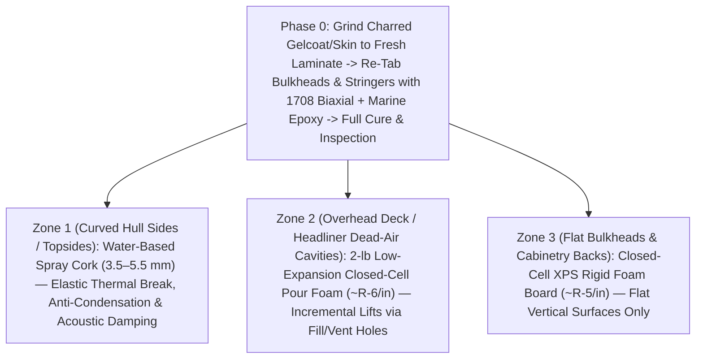

# Hull-Deck-Insulation

**2009 Beneteau Oceanis 40 (*Novella*) Post-Fire Starboard Aft Cabin Structural Tabbing & 3-Zone Thermal/Acoustic Insulation Refit**

`hull-deck-insulation` documents the structural fiberglass preparation (`1708` biaxial cloth + marine epoxy tabbing over ground-clean laminate) and **zone-specific 3-material insulation architecture** (**Spray Cork** on curved hull topsides, **`2-lb` Closed-Cell Pour Foam** in overhead deck/headliner cavities, and **Closed-Cell `XPS` Board** on flat vertical bulkheads/cabinetry) for the **2009 Beneteau Oceanis 40 (*Novella*)**.

---

## Zone-by-Zone Insulation Architecture

### Key Engineering Decisions
1. **Structural Sequencing First:** All fire-affected gelcoat and laminate were ground down to fresh glass, and all bulkheads and stringers were re-tabbed with **`1708` biaxial fiberglass and structural marine epoxy** (fully cured and inspected) prior to any insulation application.
2. **Hull Sides — Water-Based Spray Cork:** Conforms monolithically into roving textures and `1708` tabbing steps without air pockets, flexes with hull movement under sail without cracking or needing vapor-barrier tape, prevents hull sweating, and dampens wave/engine noise.
3. **Overhead Cavities — `2-lb` Closed-Cell Polyurethane Pour Foam (`~R-6/in`):** Injected in small, calculated incremental lifts through drilled fill and pressure-relief vent holes between the structural deck and molded fiberglass headliner—filling inaccessible dead-air cavities without building hydraulic pressure that could pillow or debond the ceiling liner.
4. **Flat Bulkheads — Closed-Cell `XPS` Rigid Boards (`~R-5/in`):** Used strictly behind flat vertical cabinetry and bulkheads; excluded from curved hull skins because kerfing rigid boards creates moisture-trapping air channels.
5. **Why `EVA` Foam Was Rejected:** Ruled out due to poor long-term adhesive reliability in humid marine heat cycles, lower R-value per thickness, and poor fire/smoke safety ratings.

---

## Repository Contents

* **[`hull-deck-insulation-guide.md`](hull-deck-insulation-guide.md)** — Complete structural prep sequencing, zone-by-zone material specs, incremental overhead foam injection protocol, and material comparison guide.
