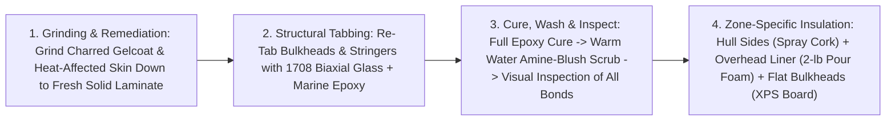
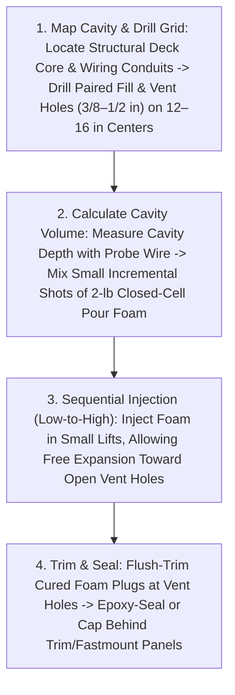

# 2009 Beneteau Oceanis 40 ("Novella") Post-Fire Hull & Deck Insulation Refit Guide

This guide documents the structural sequencing, surface preparation, and **location-specific 3-tier thermal and acoustic insulation strategy** for the **2009 Beneteau Oceanis 40 (*Novella*)**, specifically addressing the **starboard aft cabin interior refit** following post-fire remediation.

---

## 1. Refit Scope & Core Objectives

Following an aft-cabin fire on *Novella*, charred interior gelcoat, smoke-damaged cabinetry, and heat-affected fiberglass layers in the starboard aft cabin were ground down to solid laminate. Rebuilding the cabin interior presents a one-time opportunity—while bulkheads and ceiling liners are accessible—to solve three chronic issues in production fiberglass yachts:
1. **Interior Hull Condensation ("Sweating Hulls"):** Uninsulated single-skin fiberglass topsides below and above the waterline rapidly drop below the cabin dew point in cool seawater or chilly nights, causing condensation to run down behind lockers and dampen berths.
2. **Overhead Deck Heat Gain & Dead-Air Cavities:** The hollow dead-air gap (`15–35 mm`) between the structural balsa/foam-cored deck and the molded fiberglass interior headliner pan traps radiant solar heat in summer and conducts cold in winter.
3. **Acoustic Resonance:** Bare monolithic fiberglass hull skins transmit wave slap, prop/shaft hum (`Yanmar 4JH4-AE`), and dock noise directly into the sleeping quarters.

---

## 2. Mandatory Structural Sequencing & Prep (Prior to Any Insulation)

> [!IMPORTANT]
> **Never apply spray cork, pour foam, or foam boards over un-repaired laminate or uncured structural tabbing.** All structural fiberglass work must be `100%` laminated, cured, washed of amine blush, and visually inspected before any insulation touches the hull.

1. **Grinding & Surface Remediation:**
   * All fire-charred gelcoat, soot-contaminated resin, and heat-delaminated top roving in the starboard aft cabin were ground back using `36–60 grit` discs under vacuum extraction until clean, un-darkened structural fiberglass laminate was exposed.
2. **Structural Tabbing & Bulkhead Bonding (`1708` Biaxial + Marine Epoxy):**
   * Re-tabbed and structurally bonded the aft cabin bulkheads, hull stiffeners, and stringers directly to the ground-clean hull skin using **`1708` biaxial fiberglass tape/cloth (`±45°` stitched `17 oz` roving + `8 oz` mat backing)** wet out with **`100%` solids structural marine epoxy resin** (never use polyester resin for secondary structural bonds onto aged 2009 polyester laminate).
3. **Final Inspection & Amine Blush Removal:**
   * Allow all structural epoxy tabbing to reach full cure, scrub with warm water and Scotch-Brite pads to remove any waxy epoxy amine blush, and wipe dry with denatured alcohol/IPA before proceeding to insulation.

---

## 3. Location-Specific Insulation Architecture (3-Material Strategy)

Because a sailboat hull and deck contain three fundamentally different structural geometries (**compound-curved flexing hull sides**, **enclosed hollow overhead headliner cavities**, and **flat vertical bulkhead/cabinet backs**), no single insulation material works everywhere.

| Vessel Zone | Selected Material | Target Thickness & R-Value | Primary Engineering Rationale |
| :--- | :--- | :--- | :--- |
| **1. Curved Hull Sides & Topsides** | **Water-Based Spray Cork Coating** | `3 – 6 mm` (`2–3` spray coats; thermal break + acoustic damping) | Bonds monolithically to compound curves and `1708` tabbing overlaps; flexes elastically with hull panting under sail without cracking, debonding, or trapping moisture behind tape seams. |
| **2. Overhead Deck / Headliner Cavities** | **`2-lb` Low-Expansion Closed-Cell Polyurethane Pour Foam** | Fills `15 – 40 mm` dead-air cavity (`~R-6.0 to R-6.5 per inch`) | Injected in controlled incremental lifts via drilled fill/vent holes; eliminates dead-air convection, bonds deck to headliner acoustically, and avoids high-pressure headliner pillowing. |
| **3. Flat Bulkheads & Cabinetry Backs** | **Closed-Cell Extruded Polystyrene (`XPS`) Rigid Board** | `12 – 25 mm` (`1/2"` to `1"`, `~R-5.0 per inch`) | High compressive stiffness and moisture immunity on flat vertical panels behind joinery; strictly excluded from curved hull skins where kerf cuts create condensation pockets. |
| *Discarded Option* | *EVA Closed-Cell Foam Rolls/Sheets* | *Rejected* | *Peels/debonds in humid marine bilge/hull heat cycles; lower R-value per mm; poor fire/smoke toxicity profile in an aft-cabin refit.* |

---

### Zone 1: Hull Sides & Topsides — Water-Based Spray Cork

Applying rigid boards or contact-cemented foam rolls over the compound-curved interior of a Beneteau 40 hull Inevitably leaves microscopic air pockets over roving ridges and `1708` bulkhead tabbing transitions—creating hidden condensation traps.

* **Material:** Marine-grade **water-based sprayable cork coating** (granulated natural cork suspended in a flexible water-borne acrylic/elastomeric binder, e.g., *Vipeq*, *Suberlev*, *SeaCork*, or equivalent architectural/marine spray cork).
* **Application Protocol:**
  1. Mask off bonding lands where future joinery cleats or mechanical fasteners require bare epoxy-glass contact.
  2. Apply using a hopper texture spray gun (`4–6 mm` nozzle at `40–60 PSI`) in **`2 to 3 thin cross-hatched passes`** (`1.5–2.0 mm` per coat, allowing each coat to dry for `12–24 hours`) to build a total dry film thickness of **`3.5–5.5 mm`**.
* **Key Performance Advantages:**
  * **Monolithic Zero-Gap Bond:** Conforms `100%` into woven roving textures, stringer corners, and `1708` tabbing steps with zero air voids—if there is no air pocket against the cold fiberglass skin, moisture cannot condense behind the insulation.
  * **Elasticity Under Sail:** Flexes naturally (`>25%` elongation) as the hull works in a seaway without cracking, crumbling, or delaminating.
  * **Thermal Break + Acoustic Damping:** Raises interior surface temperature above the cabin dew point (stopping hull sweating) while damping high-frequency wave slap and engine-room structure-borne noise.
  * **Safe Water-Based Chemistry:** Zero toxic contact-cement solvent fumes inside a confined aft cabin, and natural cork is inherently fire-retardant and self-extinguishing (does not melt/drip like synthetic foams).

---

### Zone 2: Overhead Deck & Headliner Cavities — `2-lb` Closed-Cell Pour Foam

Like most modern production cruisers, the 2009 Beneteau 40 uses a **molded fiberglass interior ceiling pan (headliner)** bonded beneath the structural deck, leaving an inaccessible `15–40 mm` hollow dead-air cavity overhead.

* **Material:** **Two-part (`A+B`) low-expansion `2 lb/ft³` (`32 kg/m³`) closed-cell rigid polyurethane pour foam** (`~R-6.0 to R-6.5 per inch`, `>95%` closed-cell content—impervious to water absorption).
* **Injection Protocol & Critical Precautions:**
  1. **Pre-Verify Wiring Conduits:** Before foaming any overhead zone, verify that all overhead lighting and deck-hardware wiring runs inside sealed PVC/split-loom conduits (or pull a spare messenger line) so wires are not permanently locked into raw foam.
  2. **Drill Paired Fill & Pressure-Relief Vent Holes:** Drill `3/8"` to `1/2"` (`10–12 mm`) holes at `12"–16"` intervals across the cavity boundary. **Every injection zone must have adjacent open vent holes** so displaced air and excess expanding foam can escape freely without building hydraulic pressure.
  3. **Incremental Low-Volume Lifts ("Pour Short, Never Over-Pack"):**
     * **Critical Hazard — Headliner "Pillowing":** The molded fiberglass headliner pan is thin (`2–3 mm`) and held up by adhesive dabs around the perimeter. Pouring too much liquid foam at once traps expanding gas before it can reach a vent hole, generating `>5–15 PSI` (`35–100 kPa`) of hydraulic pressure that **warps ("pillows") or pops the fiberglass headliner off the overhead deck!**
     * **Safe Technique:** Warm both `Part A` and `Part B` to `75°F–80°F` (`24°C–27°C`) so the reaction is fast and predictable; inject small, calculated volumes (`60–120 mL` mixed liquid per shot, expanding `~15×` to `1–1.8 L`), starting from the lowest/outboard edge of the cambered headliner and working upward toward the centerline vents one lift at a time.

---

### Zone 3: Flat Bulkheads & Cabinetry Backs — Closed-Cell `XPS` Rigid Foam Boards

* **Material:** **Closed-cell Extruded Polystyrene (`XPS`) rigid foam board** (`Owens Corning Foamular` / `Dupont Styrofoam`, `~R-5.0 per inch`, compressive strength `15–25 PSI`, `<0.3%` water absorption).
* **Where Used:**
  * Adhered with marine polyurethane adhesive (`Sikaflex` / `3M 5200/4000` or foam-safe construction adhesive) and perimeter-sealed onto **strictly flat vertical surfaces**: the hidden backs of plywood structural bulkheads (especially the engine-room / aft-cabin divider bulkhead and locker backs) and flat under-berth/cabinetry panels.
* **Why `XPS` Was Strictly Excluded From Curved Hull Sections:**
  * Attempting to bend rigid `XPS` or `PIR` foam boards onto a curved boat hull requires kerfing (saw-scoring) the back of the board. Those kerf slots create dozens of linear air channels directly against the cold hull skin that fill with humid cabin air, condense liquid water, and cannot drain or dry out. **Rule: Spray cork on curves; `XPS` board on flat panels only.**

---

### Zone 4: Why EVA Foam Was Evaluated and Rejected

Closed-cell `EVA` (Ethylene Vinyl Acetate) foam sheets/rolls are widely marketed for DIY van and boat conversions, but were explicitly ruled out for *Novella*'s aft-cabin refit for three engineering reasons:
1. **Adhesive Creep & Failure in Marine Humidity/Heat:** Pre-applied PSA backings and contact cements on flexible `EVA` routinely peel and sag from overhead and upper-topside fiberglass after 1–2 summers of `110°F+` (`43°C+`) cabin temperatures and high humidity.
2. **Inferior Thermal Performance:** `EVA` has a higher thermal conductivity (`~R-3.2 to R-3.6 per inch`) than `XPS` (`R-5.0`) or `2-lb` closed-cell polyurethane (`R-6.2`).
3. **Fire & Smoke Toxicity Risk:** On a vessel undergoing a post-fire rebuild, lining the sleeping cabin hull with large sheets of combustible `EVA` foam (which melts, drips flaming droplets, and releases dense toxic smoke when ignited) poses an unacceptable safety hazard compared to self-extinguishing **natural spray cork** and **lined/enclosed `XPS` / `2-lb` polyurethane**.
